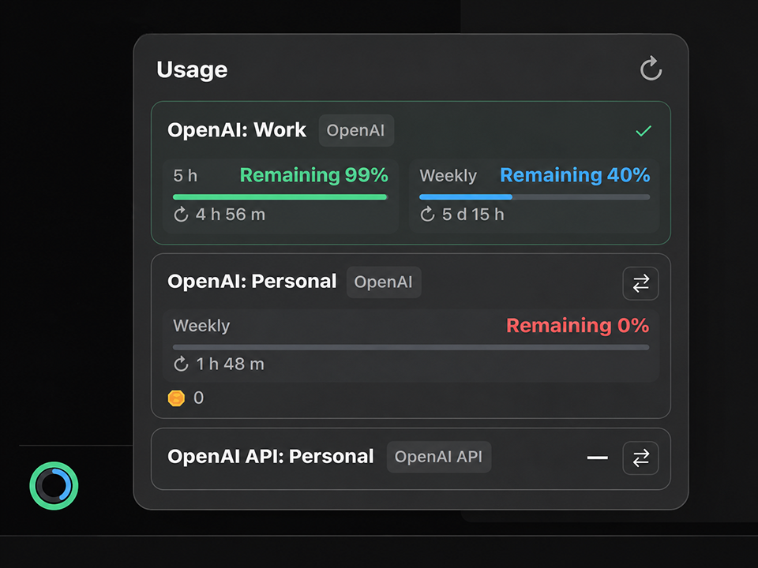

# Usage Dashboard

[](https://github.com/ItanBlackwell/usage-dashboard/releases/latest)
[](https://github.com/ItanBlackwell/usage-dashboard/actions/workflows/ci.yml)
[](LICENSE)


**Monitor AI-provider usage limits, API balances, and multiple accounts directly in OpenCode Desktop.**

Usage Dashboard is an **open-source** plugin for
**OpenCode Desktop**. It shows supported AI-provider quota windows, connected
accounts and balances where available, and provides quick account switching.
The OpenCode GUI SDK is experimental and its sidebar DOM can change across
Desktop versions.

> **License:** [Mozilla Public License 2.0](LICENSE) (`MPL-2.0`).
> You may use, modify, redistribute, and commercially use the software subject
> to the MPL 2.0 terms, including the source-sharing requirements for covered files.

## Preview

<p align="center">
  
</p>

*Illustrative example with demonstration account data.*

## Installation (Windows)

1. Download **Usage-Dashboard-Portable-0.14.0.zip** from the [latest GitHub Release](https://github.com/ItanBlackwell/usage-dashboard/releases/latest).
2. Extract the ZIP and completely close OpenCode Desktop.
3. Run **`Install.cmd`** by double-clicking it, then restart OpenCode.
4. Go to **Settings → General → Interface layout** and choose **Side tabs**, **Inbox**, or **Top tabs**.
5. Look for the circular Usage Dashboard indicator in the lower-left corner (inside the sidebar when present).

No separate Node.js, OpenCode CLI or manual PowerShell commands are required
for Portable installation. The script uses built-in Windows PowerShell.

**Note:** Top tabs uses a compact floating indicator with 16 px edge spacing; layout compatibility depends
on the experimental Desktop DOM. If the indicator is missing, restart OpenCode.

See [Installation and troubleshooting](docs/INSTALLATION.md) for details.

### OpenCode Console budgets and credits

Existing OpenCode pay-as-you-go connections are queried automatically. No
additional sign-in, key, browser session or extension is required by the plugin.
The experimental Console integration reads applicable budget policies and, when
permitted, the workspace prepaid credit balance. These are distinct metrics;
overlapping budget policies are not added together. The sidebar shows a prepaid
balance when available, otherwise the tightest applicable general budget with an
amber ring and a budget tooltip.

If the existing connection lacks permissions, the affected metric remains
unavailable. An empty budget response is not a zero allowance. OpenAI API
prepaid credit balances are not exposed by a supported public API; the
organization Costs API remains available with a configured Admin API key.

See [OpenCode budgets and credits](docs/OPENCODE_BUDGETS.md).

## Compatibility and limits

- **OpenAI/Codex subscription quotas** (5-hour and weekly) require
  **Codex browser (legacy)** or **Codex device code (legacy)** authorization.
  The newer **Sign in with ChatGPT** flow does not expose the required quota
  data to this plugin.
- Supported account connections include OpenAI/Codex, Anthropic/Claude,
  DeepSeek, Moonshot/Kimi, Kimi Coding, OpenRouter, Z.AI/GLM, MiniMax,
  Google Gemini, Alibaba Qwen, OpenCode (pay-as-you-go / Zen) and OpenCode Go.
  Actual quota/balance availability depends on the account type, provider API
  and authorization method.
- OpenCode Go uses the [official usage endpoint](https://opencode.ai/docs/console/go/#usage)
  for 5-hour, weekly and monthly limits. Connected OpenCode pay-as-you-go
  accounts are displayed even when budgets or prepaid credits are unavailable.
- Confirmed zero balances are displayed with two decimal places and currency.
- Missing data is shown as unavailable, never assumed to mean a zero balance.
  Temporary provider errors preserve the last confirmed API balance.
- The experimental OpenCode GUI SDK may change without backward compatibility.

## Financial metrics and availability

Usage Dashboard reuses existing provider connections. Wallet balances, key
spending caps, organization analytics and subscription quotas remain distinct.
The compact view prioritizes wallet balances and remaining quota bars.
When no wallet is available, a verified spending cap is shown separately as
a budget; unavailable balances use a dash rather than zero, and unavailable
quotas are identified separately.
Expand **Statistics & details** to inspect spending, tokens, model counters,
additional budget policies and detailed availability reasons.
When a wallet, general spending cap or subscription quota cannot be read, a
separate collapsed **OpenCode usage estimate** section provides today's and
the current month's recorded local usage (UTC), aggregated by provider
across accounts. It is not a provider charge, account balance or quota.

Since version 0.14.0, browser-based billing and the companion extension are retired.
Existing provider connections are used directly; no extra browser login is required.

See [provider metrics and endpoints](docs/PROVIDER_METRICS.md) for the
supported and experimental contracts.

## Features

- Lower-left icon with colored quota rings and a compact account popup across all three layouts.
- Five-hour and weekly quota windows, plus monthly windows where supported.
- Hover over a quota reset countdown to see its exact local reset time.
- Serialized account switching: new selections replace pending unstarted
  requests, preventing stale updates from overriding the latest click.
- Cached, refreshed usage summaries. Account credentials stay in the host
  process and are never passed to the GUI or saved in the usage cache.
- Automatic [OpenCode Console budget and credit monitoring](docs/OPENCODE_BUDGETS.md)
  through existing provider credentials, subject to permissions.


## Community and feedback

- [Report a bug](https://github.com/ItanBlackwell/usage-dashboard/issues/new/choose)
- [Suggest a feature](https://github.com/ItanBlackwell/usage-dashboard/issues/new/choose)
- [Browse releases](https://github.com/ItanBlackwell/usage-dashboard/releases)
- [Contributing guide](CONTRIBUTING.md)

## Development and contributions

Requirements for building from source: Node.js 22+ and Python 3.
No additional npm packages or network downloads are needed for packaging.

```sh
node build.cjs
node --check dist/gui-experimental.cjs
python3 tools/make-distributions.py
```

No standalone test scripts are included in this repository; GitHub Actions
performs syntax, archive and Windows installer smoke checks. These checks do
not substitute for testing the live OpenCode Desktop GUI.

See [CONTRIBUTING.md](CONTRIBUTING.md), [SECURITY.md](SECURITY.md), and the
[OpenCode GUI SDK documentation](https://opencode.ai/docs/build/plugins/gui/).

## Privacy and acknowledgments

Usage Dashboard communicates with connected provider endpoints to obtain
available usage data; it is not an official product of OpenCode or the AI
providers it integrates with. It does not launch browsers, inspect browser
profiles, or require extensions or an HTTP receiver for financial metrics.
Do not share credentials or cached private information.

Copyright (c) 2026 ItanBlackwell. Licensed under MPL-2.0.
See [LICENSE](LICENSE) and [NOTICE](NOTICE).
